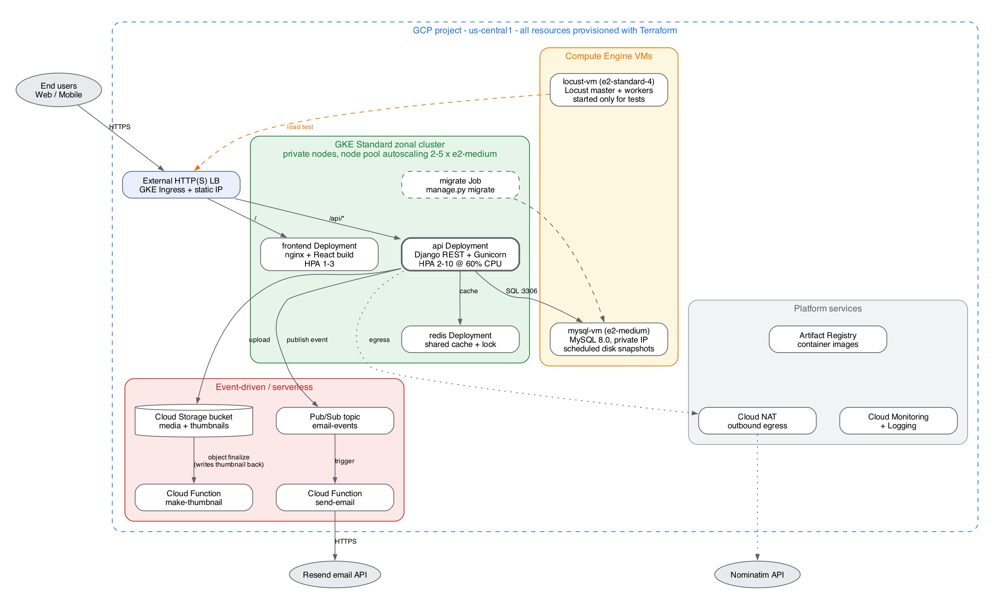

# StoryMap – Cloud-Native on GCP

CMPE 48A (Cloud Computing) term project. The project deploys
**Local History Story Map**, a Django + React platform for location-based
community stories, as a cloud-native system on **Google Cloud Platform**. The
infrastructure is provisioned with **Terraform**.

> Application code is reused from our earlier software-engineering course
> project ([bounswe/bounswe2026group4](https://github.com/bounswe/bounswe2026group4)).
> Everything under `terraform/`, `k8s/`, `functions/`, `locust/` and `docs/`
> is new work for this course.

## Architecture



| Requirement | Implementation |
|---|---|
| Containerised workloads on Kubernetes | GKE: `api` (Django/Gunicorn) and `frontend` (nginx) Deployments with HPA, `redis` cache, `migrate` Job |
| Virtual machines | Compute Engine: `mysql-vm` (MySQL 8.0, private IP) and `locust-vm` (load generator) |
| Serverless functions | Cloud Functions: `send-email` (Pub/Sub trigger), `make-thumbnail` (GCS trigger) |
| Infrastructure as Code | Terraform for the VPC, NAT, GKE, VMs, GCS, Pub/Sub, Functions, Artifact Registry and billing budget |

See the [Phase 1 report](docs/phase1/phase1-report.pdf) for details and the cost estimate.

## Repository layout

```
app/          Application source (backend, frontend, nginx) + Docker/Compose files
terraform/    GCP infrastructure as code
k8s/          Kubernetes manifests (Deployments, Services, HPA, Ingress, Job)
functions/    Cloud Functions source (send-email, make-thumbnail)
locust/       Locust load-test scripts and results
docs/         Reports, diagrams
```

## Running the application locally

```bash
cd app
cp .env.example .env      # fill in SECRET_KEY, DB_PASSWORD, DB_ROOT_PASSWORD, NOMINATIM_CONTACT_EMAIL
docker compose up --build
```

| Service | URL |
|---|---|
| API | http://localhost:8000 |
| Frontend | http://localhost:5173 |
| Mailpit inbox | http://localhost:8025 |

## Deploying to GCP

*Work in progress. Step-by-step Terraform and Kubernetes deployment
instructions will be added here.*

## Status

- [x] Phase 1 – team, application, tentative architecture, cost estimate
- [ ] Cloud-native app changes (GCS media, Redis cache, Pub/Sub e-mail)
- [ ] Terraform infrastructure
- [ ] Kubernetes manifests
- [ ] Cloud Functions
- [ ] Locust experiments and final report
