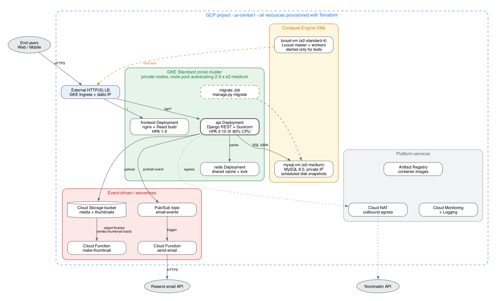

# 1. Team

| Role | Name |
|---|---|
| Student 1 | Aysu Keskin |
| Student 2 (partner) | **[Partner Name]** |

# 2. Application Code

**Repository:** <https://github.com/AysuKeskin/storymap-cloud-native>

The application is *Local History Story Map*, a platform where users discover
and publish location-based community stories through a map, a feed, a
timeline and full-text search. We reuse the application code that was
developed earlier in the CMPE 354/451 software-engineering course
(original upstream: <https://github.com/bounswe/bounswe2026group4>). The
cloud-native design, the Kubernetes manifests, Terraform code, Cloud Functions
and Locust tests are new work for this course.

| Layer | Technology |
|---|---|
| Backend API | Django 4.2 + Django REST Framework, Gunicorn, JWT auth |
| Web frontend | React + Vite, served by nginx |
| Mobile client | Expo / React Native (consumes the same API) |
| Database | MySQL 8.0 |
| Already containerised | Dockerfiles for backend and nginx/frontend, Docker Compose |

Main API domains: users and authentication, stories (map / feed / timeline /
search), media uploads, comments and likes, tags, notifications,
gamification (badges) and a geocoding proxy to OpenStreetMap Nominatim.

**Changes planned to make the app cloud-native**

1. Move media storage from the local disk to **Cloud Storage** with
   `django-storages`, so that API pods are stateless and can be scaled freely.
2. Replace the per-process in-memory cache with a shared **Redis** cache.
   This also gives a distributed rate-limit lock for the Nominatim proxy,
   which today works only within one process.
3. Move e-mail sending out of the request path. The API publishes an event to
   **Pub/Sub** and a **Cloud Function** sends the e-mail.
4. Add **image thumbnail generation** as a Cloud Function triggered by uploads
   to the bucket.
5. Read all configuration from Kubernetes Secrets and ConfigMaps, and run
   database migrations as a Kubernetes `Job`.

# 3. Tentative Cloud Architecture

## 3.1 Components

| Component | GCP service | Role in the system |
|---|---|---|
| **Load balancer** | External HTTP(S) LB (created by GKE Ingress), static IP | Single public entry point. Routes `/api/*` to the API service and `/` to the frontend. |
| **frontend** | GKE Deployment (+ HPA 1–3) | nginx serving the compiled React app. Lightweight and stateless. |
| **api** | GKE Deployment (+ HPA 2–10 at 60 % CPU) | Django REST API on Gunicorn. Main scaling target and the focus of the performance tests. |
| **redis** | GKE Deployment + ClusterIP Service | Shared cache for hot read endpoints (`/stories/map`, `/stories/feed`, `/stories/timeline`), geocoding results and a distributed lock. Runs in-cluster instead of Memorystore to save budget. |
| **migrate** | Kubernetes Job | Runs `manage.py migrate` before each rollout. |
| **mysql-vm** | Compute Engine VM (e2-medium) | MySQL 8.0 on a private IP, reachable only from inside the VPC. Persistent disk with a scheduled snapshot policy. Chosen over Cloud SQL for cost and to satisfy the VM requirement with a stateful, functional role. |
| **locust-vm** | Compute Engine VM (e2-standard-4) | Runs Locust master and workers. Started only during experiments so that load is generated outside the cluster it is measuring. |
| **Media bucket** | Cloud Storage | Stores user-uploaded images, audio and video, plus generated thumbnails. |
| **make-thumbnail** | Cloud Function (2nd gen), GCS *object finalize* trigger | Creates resized thumbnails for every uploaded image and writes them back to the bucket. |
| **email-events** | Pub/Sub topic | Asynchronous queue that decouples the API from e-mail delivery (registration verification, password reset, notifications). |
| **send-email** | Cloud Function (2nd gen), Pub/Sub trigger | Consumes `email-events` and sends the message through the Resend e-mail API. Retries on failure. |
| **Artifact Registry** | Docker repository | Stores the `api` and `frontend` images built by GitHub Actions. |
| **Cloud NAT** | Cloud Router + NAT | Outbound internet access for private GKE nodes and VMs (Nominatim, package installs). Nothing in the VPC has a public IP. |
| **Cloud Monitoring / Logging** | Managed | CPU, memory, pod count, LB latency and error metrics used in the performance evaluation. |

## 3.2 Interactions

1. **Read path.** A request goes Client → LB → `api` pod. The pod checks Redis
   first. On a cache miss it queries MySQL on the VM and stores the result in
   Redis with a short TTL.
2. **Write path (story with media).** The `api` pod writes the story row to
   MySQL and streams the file to Cloud Storage. The bucket's *finalize* event
   triggers `make-thumbnail`, which writes the thumbnail next to the original.
3. **Asynchronous e-mail.** Registration and notification flows publish a small
   JSON message to `email-events` and return immediately. `send-email` then
   delivers the message. A slow e-mail provider no longer slows down API
   requests.
4. **Scaling.** The HPA adds `api` pods when average CPU exceeds 60 %. The GKE
   cluster autoscaler adds nodes (2 → 5) when pods cannot be scheduled.
5. **Deployment.** Terraform creates the VPC, NAT, GKE cluster, VMs, bucket,
   Pub/Sub topic, Cloud Functions, Artifact Registry and a billing budget.
   Kubernetes manifests (Deployments, Services, HPA, Ingress, Job) are then
   applied with `kubectl`.

## 3.3 Planned performance experiments (preview)

Locust user classes will simulate (a) anonymous visitors browsing the map,
feed and story details, (b) logged-in users who like and comment, and
(c) content creators who post stories with images.

| Independent variables | Dependent variables |
|---|---|
| Number of concurrent users and spawn rate | p50 / p95 / p99 latency |
| Read vs. write traffic mix | Throughput (requests per second) |
| Redis cache on vs. off | Error rate |
| HPA on (2–10 pods) vs. fixed replicas | CPU and memory of pods and the MySQL VM |
| Synchronous vs. Pub/Sub e-mail | Pod and node count over time |

# 4. Cost Estimation

Prices are **list prices for `us-central1`** from the GCP pricing pages and
calculator. They will be re-checked in the Pricing Calculator before
deployment. We assume about **two months** of usage (mid-November to mid-January).

## 4.1 Monthly baseline (system running 24/7)

| Resource | Configuration | Unit price | Monthly cost |
|---|---|---|---|
| GKE cluster management fee | 1 zonal Standard cluster | $0.10/h (≈ $73) | **$0.00** (covered by the $74.40/month GKE free-tier credit) |
| GKE nodes | 2 × e2-medium (2 vCPU, 4 GB) | $0.0335/h each | $48.92 |
| Node boot disks | 2 × 30 GB pd-standard | $0.04/GB-month | $2.40 |
| mysql-vm | 1 × e2-medium | $0.0335/h | $24.46 |
| mysql-vm disk + snapshots | 20 GB pd-balanced + ~5 GB snapshots | $0.10 and $0.05/GB-month | $2.25 |
| HTTP(S) Load Balancer | 1 forwarding rule | $0.025/h | $18.25 |
| Cloud NAT | 3 VM endpoints + low traffic | $0.0014/h per VM + $0.045/GB | $3.57 |
| Cloud Storage | ~2 GB Standard | $0.020/GB-month | $0.04 |
| Artifact Registry | ~2 GB images (0.5 GB free) | $0.10/GB-month | $0.15 |
| Cloud Functions (2nd gen) | < 100k invocations/month | free tier: 2M req, 180k vCPU-s | $0.00 |
| Pub/Sub | < 1 GB/month | first 10 GiB free | $0.00 |
| Monitoring and Logging | within free allotment (50 GiB logs) | — | $0.00 |
| Internet egress | ~5–10 GB | ~$0.12/GB | ~$1.00 |
| **Total per month** | | | **≈ $101** |

## 4.2 Load-testing campaign (one-off, ~30 test hours)

| Resource | Usage | Cost |
|---|---|---|
| locust-vm e2-standard-4 | 30 h × $0.134/h + 20 GB disk | $4.82 |
| Extra GKE nodes from autoscaling | up to 3 × e2-medium × 30 h | $3.02 |
| LB data processing and egress | ~50 GB × $0.008/GB + misc. | $1.50 |
| Cloud Functions / Pub/Sub under load | still within free tier | $0.00 |
| **Total** | | **≈ $9.50** |

## 4.3 Project total vs. the $300 credit

| Scenario | Calculation | Total | Share of $300 |
|---|---|---|---|
| Worst case: everything always on | 2 × $101 + $9.50 | **≈ $212** | 71 % |
| Planned: shut down when idle | baseline ~50 % of the time + tests | **≈ $110–120** | ~40 % |

**Cost-control measures**

- `terraform destroy`, or scaling the node pool to 0 and stopping `mysql-vm`
  when the system is not needed. Everything can be recreated from code in
  about 15 minutes.
- `locust-vm` runs only during experiments and can use **Spot** pricing
  (~60–90 % cheaper).
- Small e2 machine types and pd-standard boot disks instead of the 100 GB
  default.
- Redis and MySQL are self-hosted, which avoids Memorystore (~$35+/month) and
  Cloud SQL (~$25–50/month).
- A **billing budget with alerts at 50 %, 75 % and 90 %** of $300 is created
  by Terraform (`google_billing_budget`).
